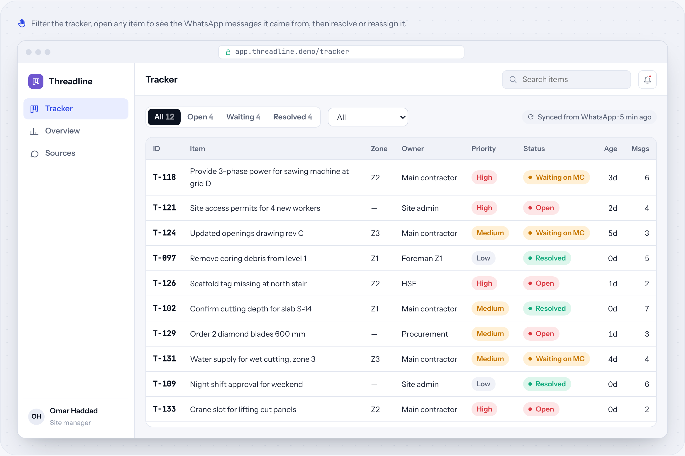
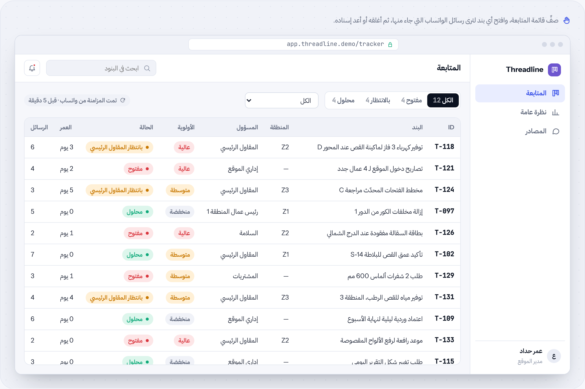

# Threadline

**Group chat → task & issue tracker** · AI automation · by [HUDERA AI](https://www.linkedin.com/company/hudera)

Reads busy project group chats and keeps a live tracker of every request and issue, with owner, status and the messages it came from.

**[▶ Try the live demo](https://hudera-ai.github.io/threadline/)** · runs in your browser on sample data · Arabic & English

## The problem
Requests and problems are raised inside long group chats and voice notes. Items get buried, duplicated, or forgotten, and nobody can say what is still waiting on whom.

## What it does
Threadline reads the group, transcribes voice notes, turns each request into a tracked item, updates existing items instead of duplicating them, and marks unknown details as “Not specified” instead of guessing.

## Business value
Everyone works from one list. Open items, items waiting on others and resolved items are visible at a glance, each linked back to its source messages.

## Features
| Feature | Details |
| --- | --- |
| Full group survey | From the first message |
| Voice notes | Transcribed and itemised |
| Source links | Every item shows its messages |
| No duplicates | Repeats update the same item |
| Filters & owners | By status, owner, zone |
| Overview | Age and owner breakdown |

## How the workflow runs
**Trigger**: New messages → **Read**: Text & voice → **Classify**: Request or issue → **Merge**: Update or create → **Track**: Live tracker

## Typical stack
WhatsApp export / API · Speech-to-text · LLM classification · Excel or web tracker

## Run it locally
Open `index.html` in any modern browser. No build step, no server, no data leaves your machine.

---

## Threadline بالعربي

**محادثات المجموعات ← متابعة المهام والمشكلات**

يقرأ مجموعات المشروع المزدحمة ويحافظ على متابعة حية لكل طلب ومشكلة، مع المسؤول والحالة والرسائل التي جاء منها.

### المشكلة
الطلبات والمشكلات تُطرح داخل محادثات طويلة وملاحظات صوتية، فتضيع أو تتكرر أو تُنسى، ولا أحد يعرف ما الذي ما زال ينتظر من.

### ما الذي يفعله
يقرأ Threadline المجموعة، ويفرّغ الملاحظات الصوتية، ويحوّل كل طلب إلى بند متابَع، ويحدّث البنود الموجودة بدل تكرارها، ويكتب «غير محدد» للتفاصيل غير المعروفة بدل التخمين.

### القيمة للأعمال
الجميع يعمل من قائمة واحدة. البنود المفتوحة والمنتظرة والمحلولة واضحة بنظرة، وكل بند مرتبط برسائله الأصلية.

### المزايا
| الميزة | التفاصيل |
| --- | --- |
| مسح كامل للمجموعة | من أول رسالة |
| الملاحظات الصوتية | تُفرَّغ وتُحوَّل إلى بنود |
| روابط المصدر | كل بند يعرض رسائله |
| بدون تكرار | التكرار يحدّث نفس البند |
| فلاتر ومسؤولون | حسب الحالة والمسؤول والمنطقة |
| نظرة عامة | توزيع حسب العمر والمسؤول |

### كيف يسير العمل
**المُشغِّل**: رسائل جديدة ← **القراءة**: نص وصوت ← **التصنيف**: طلب أو مشكلة ← **دمج**: تحديث أو إنشاء ← **Track**: متابعة حية

---

## About HUDERA AI
HUDERA AI builds WhatsApp AI assistants, business dashboards, workflow automations and custom SaaS products for companies in Saudi Arabia and the Gulf.

- LinkedIn: [linkedin.com/company/hudera](https://www.linkedin.com/company/hudera)
- Email: hudera.ai@gmail.com
- WhatsApp: [+20 155 515 9139](https://wa.me/201555159139)

> This repository is a product demo. Company names, people and figures inside it are fictional sample data.

© 2026 HUDERA AI. All rights reserved.
